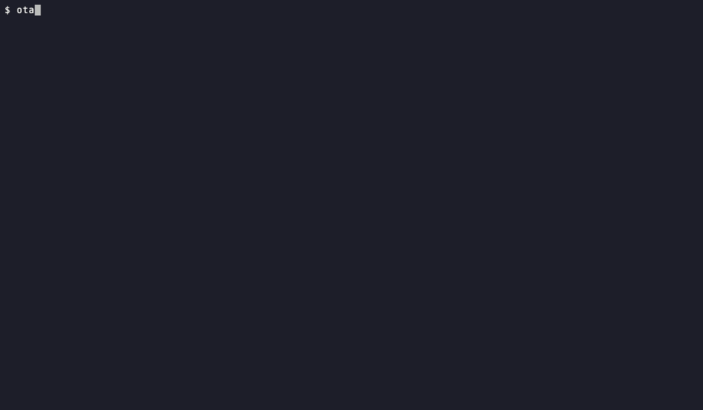

# otag

A command tent for your AI coding agents.

[](https://github.com/nesiler/otag/actions/workflows/ci.yml)
[](https://github.com/nesiler/otag/releases/latest)
[](go.mod)
[](LICENSE)


<p align="center"></p>

## What is otag?

otag coordinates AI coding agents (Claude Code, Codex CLI and OpenCode) on your own Mac, across one or more
existing projects. A coordinator agent splits the work into tasks; child agents work on them in isolated git
worktrees inside a private tmux server; you watch and steer everything from one terminal UI.

- **Tasks and runs.** A task is a unit of work with a status machine (draft, ready, running, waiting, review,
  done, delivered). Every attempt is a run. When a run hits a quota limit or fails to launch, the daemon starts a
  new run with the profile's fallback; crashed or stalled runs fall back too if you add them to `fallback_on`.
- **Isolation.** One git worktree and branch (`otag/<task>`) per task. otag never writes into your project's
  working tree.
- **Review flow.** A finished task can spawn a linked review task, ideally on a different model; the reviewer
  accepts or rejects.
- **Messaging with proven delivery.** Agents and humans exchange questions, replies and commands (`otag send`,
  `otag ask`, `otag inbox`, `otag reply`). A child can park itself while waiting for an answer and is resumed when
  the reply arrives.
- **Guard.** Hooks block dangerous actions: `git push`, git operations on other refs or on the main checkout,
  writes outside the worktree, and deny-listed files such as `.env*`. Two levels: `light` (default) and `strict`
  (behind the harness's native sandbox where available). The guard protects against accidents, not against a
  malicious agent.
- **Quota tracking.** Per-account quota windows, cooldowns and profile fallback (`otag quota`).
- **Delivery.** otag never merges. A done task is "ready to deliver"; each project delivers its own way (the
  coordinator, a delivery agent, or you), then `otag task deliver` marks it delivered and removes the worktree.
- **Terminal UI.** `otag tui` is mouse-driven with a live pane preview, a typing mode that forwards keys to the
  agent, and full-screen attach.

State comes from harness hooks and a SQLite database, not from screen scraping.

## Why "otag"?

*Otag* (Turkish *otağ*) was the command tent of a Turkic or Ottoman ruler on campaign: the headquarters from
which the campaign was coordinated.

## Requirements

- macOS (Apple Silicon or Intel)
- `tmux` and `git`
- at least one agent CLI: `claude`, `codex` or `opencode`

## Install

Homebrew (builds from source; Homebrew fetches Go and tmux for you):

```sh
brew install nesiler/tap/otag
```

Install script (honors `OTAG_VERSION` and `OTAG_INSTALL_DIR`):

```sh
curl -fsSL https://raw.githubusercontent.com/nesiler/otag/main/install.sh | sh
```

From source (pure Go, no cgo):

```sh
go install github.com/nesiler/otag/cmd/otag@latest
```

`otag --version` prints the version (`otag version --json` too).

### Verifying a release

Every release archive comes with a SHA-256 checksum (`checksums.txt`, checked by the install script), an SBOM,
and a signed build provenance attestation that proves it was built from this repository by its release workflow:

```sh
gh attestation verify otag_<version>_darwin_arm64.tar.gz --repo nesiler/otag
```

## Quick start

1. **Run `otag` inside a project.** In a git repository you want agents to work on:

   ```sh
   cd ~/dev/myapp
   otag
   ```

   On first run this starts a short setup wizard (the same as `otag init`): it finds Claude Code, Codex and
   OpenCode on your PATH, proposes profiles for them (models, effort, fallbacks), registers the repository as a
   project, offers to install the background daemon, shows exactly which files it will write, writes them and
   loads them. Nothing is written until you confirm; Esc cancels. No terminal (CI, a script)? Use
   `otag init --yes`. Details: [docs/SETUP.md](docs/SETUP.md).

2. **Open the TUI and start the coordinator.** The wizard ends by offering the TUI; later, plain `otag` opens it.
   Select the project and press `c` to start its coordinator, or from the shell:

   ```sh
   otag coord myapp --attach   # the project's coordinator agent; tell it what to build
   otag tui                    # the full-screen view (also: plain `otag`)
   ```

3. **More projects:** `otag project add` inside another repository (`otag project list`, `otag project remove`).
   **Check the setup:** `otag doctor`; every problem comes with the command that fixes it.

The coordinator creates tasks with `otag task add` and starts children with `otag run start <task>`; you can do
the same by hand. Useful commands: `otag status`, `otag needs` (what waits for you), `otag inbox`, `otag quota`,
`otag stats`, `otag notify list`. `otag prime` prints orientation (identity, task, allowed commands, unread
messages) for the calling agent. Add `--json` to any command for a versioned machine-readable envelope.

### Manual configuration

The wizard writes plain, commented TOML: `~/.config/otag/registry.toml` (accounts and profiles) and
`~/.config/otag/projects/<name>.toml` (one per project). Edit them, then run `otag sync`. For setups beyond the
wizard (several logins of one agent, custom model ids, strict guard, environment for API keys) see the annotated
[examples/registry.toml](examples/registry.toml) and [examples/projects/](examples/projects/), and
[docs/SETUP.md](docs/SETUP.md#manual-configuration).

## Concepts

| Concept | Meaning |
|---|---|
| Project | A registered repo. Its own CLAUDE.md / AGENTS.md rules still apply; otag writes no files into it. |
| Task | A unit of work with a status and dependencies (`blocks`, `parent`, `review_of`, `related`). |
| Run | One attempt at a task by one profile (harness + account + model + effort). Retry or fallback means a new run. |
| Coordinator | The project's long-lived agent session that plans and creates tasks. |
| Child | An agent run working on one task in its own worktree; finishes with `otag done` or `otag fail`. |
| Review | A separate task linked with `review_of`; recorded with `otag review --accept` / `--reject`. |
| Guard | Hook-based blocking of dangerous actions, `light` or `strict`. |
| Delivery | Getting a done task's result into the project, done by the project; `otag task deliver` records it. |

## Documentation

- [Setup](docs/SETUP.md): the first-run wizard, `otag init`, projects, the generated files
- [Design](docs/DESIGN.md): goals, data model, decisions
- [Daemon](docs/DAEMON.md): watchdogs, fallback, park and resume, review, delivery
- [Adapters](docs/ADAPTERS.md): Claude Code, Codex and OpenCode integration, threat model
- [Messages](docs/MESSAGES.md): messaging and delivery proof
- [Quota](docs/QUOTA.md): quota collectors and cooldowns
- [TUI](docs/TUI.md): terminal UI design

## Status

Early alpha (v0.1), macOS only. Interfaces and the database schema may still change.

## Contributing

See [CONTRIBUTING.md](CONTRIBUTING.md).

## Security

See [SECURITY.md](SECURITY.md).

## License

[MIT](LICENSE)
